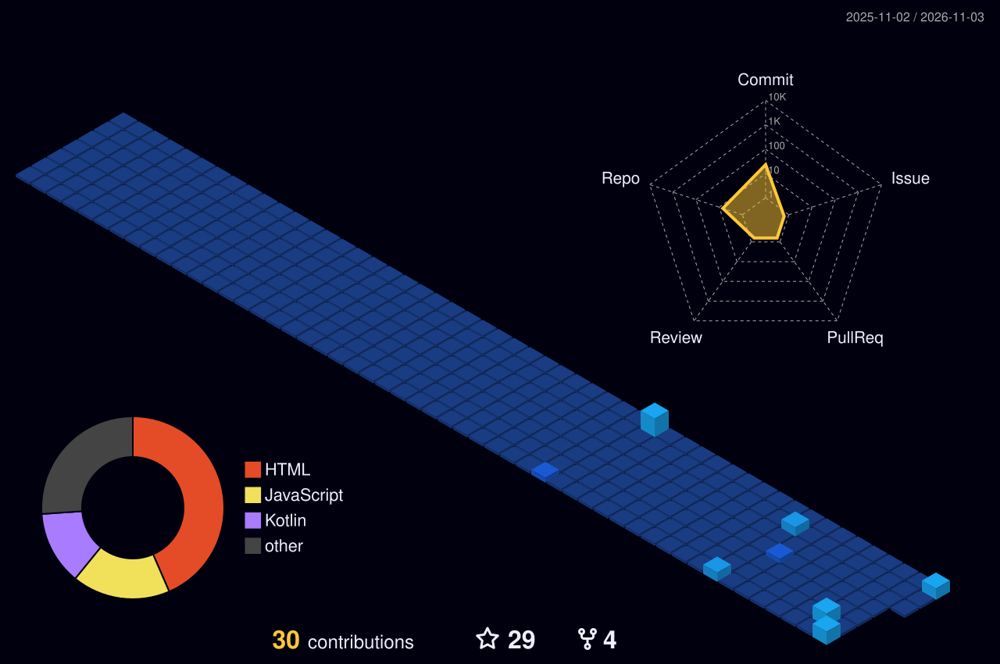

  

  

  

## 🧬 Featured builds

| Project | Language | Stars |
|---|---|:---:|
| [grab-pics](https://github.com/coregenix/grab-pics) | Shell | ⭐ 4 |
| [IPTrack](https://github.com/coregenix/IPTrack) | Python | ⭐ 4 |
| [SpamWa](https://github.com/coregenix/SpamWa) | Python | ⭐ 3 |
| [termux-interface](https://github.com/coregenix/termux-interface) | Shell | ⭐ 3 |
| [cars](https://github.com/coregenix/cars) | JavaScript | ⭐ 2 |
| [install-kali](https://github.com/coregenix/install-kali) | Shell | ⭐ 2 |

## 🌃 Contribution city

## 🤝 Connect

[**GitHub**](https://github.com/coregenix) · [**Repositories**](https://github.com/coregenix?tab=repositories) · [**Stars**](https://github.com/coregenix?tab=stars)

